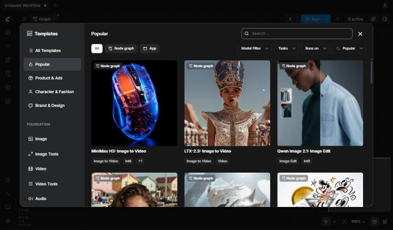
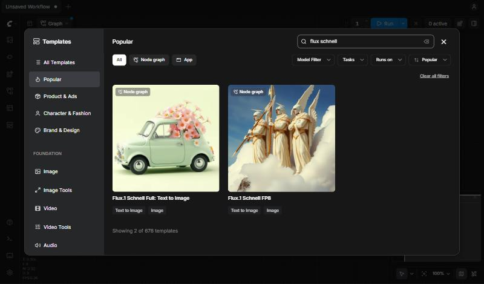
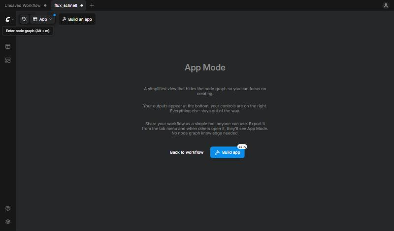

# Hướng dẫn dùng ComfyUI: cho Selorson và cho việc riêng

> Viết 2026-11-14 (Claude) cho anh. Máy: RTX 4080 16 GB VRAM, 31 GB RAM.

## 1. Bức tranh chung

Máy có **2 bản ComfyUI**, dùng **chung một kho model**:

| | Bản Akunarch | **Bản riêng của anh** |
|---|---|---|
| Thư mục | `E:\Akunarch\repos\ComfyUI` | `D:\ComfyUI-Rieng` |
| Địa chỉ | 127.0.0.1:**8188** | 127.0.0.1:**8189** |
| Ai dùng | Hàng đợi Akunarch (em và Antigravity) tự bật, tự tắt | Anh tự bấm, hoặc dặn em chạy hộ |
| Cài thêm node? | **Không.** Giữ sạch để dây chuyền Selorson không hỏng | Thoải mái (có Manager) |
| Thành phẩm | `projects\<công trình>\comfy\` | `D:\ComfyUI-Rieng\output\` |
| Kho model | `D:\AI-Models`, dùng chung. Tải một lần, cả hai bản đều thấy | ← cùng kho đó |

Ghi chú: `D:\Git-repo\ComfyUI` chỉ là lối tắt (junction) trỏ vào bản Akunarch, không phải bản thứ ba.

## 2. Bật và tắt bản riêng

1. Bấm đúp **`ComfyUI riêng`** trên Desktop. Một cửa sổ đen hiện ra. Khoảng 10–30 giây sau, trình duyệt tự mở trang ComfyUI.
2. **Muốn tắt thì đóng cửa sổ đen.** Đóng tab trình duyệt không tắt ComfyUI.

**Luật nhường card (anh chốt 2026-11-14):**
- **Lúc anh đang bật bản riêng, Akunarch tự chờ.** Job GPU của Akunarch đứng ở trạng thái chờ, kèm ghi chú "Chờ: ComfyUI riêng của anh đang bật". Anh đóng cửa sổ đen thì job tự chạy tiếp.
- **Ngược lại:** lúc anh bấm lối tắt mà Akunarch đang dùng card (ComfyUI cổng 8188 hoặc Blender), cửa sổ đen sẽ báo và **tự đợi việc đó xong mới mở**. Muốn mở ngay thì bấm phím **M**, nhưng dễ tràn VRAM.
- Vậy nên **dùng xong thì nhớ đóng cửa sổ đen**, không thì việc của Selorson bị treo.

## 3. Chạy một việc trong 5 bước

1. **Mở Templates:** bảng này thường tự hiện. Nếu không thấy, bấm biểu tượng **Templates** ở thanh trái.
2. **Tìm:** gõ tên vào ô Search, ví dụ `flux schnell`, `trellis`, `minimax h3`, `upscale`. Bên trái có lọc theo nhóm: Image, Image Tools, Video, Video Tools, Audio, 3D Model.

   
3. **Bấm vào template.** Workflow mở ra thành một sơ đồ các ô nối dây. **Anh không cần hiểu dây nối.** Chỉ cần sửa vài ô:
   - ô chữ mô tả (prompt), thường là ô màu xanh lá;
   - ô nạp ảnh (Load Image), với các việc biến ảnh thành video, 3D hoặc ảnh nét hơn;
   - kích thước, độ dài video, nếu có.
4. **Nếu thiếu model:** ComfyUI hiện hộp thoại liệt kê các file còn thiếu. **Cách chắc nhất là dặn em tải.** Em tải đúng vào `D:\AI-Models` bằng script có sẵn, tải nối tiếp được và có ghi log. Nếu anh tự bấm Download mà file rơi vào thư mục `Downloads`, hãy chuyển nó vào `D:\AI-Models\<thư mục mà hộp thoại ghi>`.
5. **Bấm `Run`** (nút xanh góc trên phải). Kết quả hiện ngay trên sơ đồ và được lưu ở `D:\ComfyUI-Rieng\output\`.

**Chế độ App (gọn hơn):** nút `Graph ▾` ở góc trên trái đổi được sang **App**. Chế độ này ẩn sơ đồ, chỉ còn ô điền và nút chạy. Một số template có nhãn **App** thì mở thẳng ở dạng này. Với workflow chưa có App, bấm **Build app** một lần để chọn ô nào hiện ra. Anh muốn thì em dựng sẵn App cho các việc anh hay làm.

## 4. Các template chạy được ngay (model đã có sẵn)

| Việc | Template (gõ tìm) | Ghi chú |
|---|---|---|
| Ảnh từ chữ | **Flux.1 Schnell FP8** | ~1–2 phút/ảnh, ăn 15,8 GB VRAM. Không chạy kèm việc nặng khác |
| Xoá nền ảnh | **Remove Background: BiRefNet** | Nhẹ |
| Ảnh → 3D `.glb` | **Pixal3D & TRELLIS.2: Image to Model** | ~1,5–2 phút. Ảnh vào nên là **1 vật, nền trắng, nhìn thẳng** |
| Ảnh → bản đồ độ sâu / lưới | **Depth Estimation: MoGe**, **MoGe: Perspective / Panorama to Mesh** | Nhẹ |
| Video có tiếng | **MiniMax H3: Image to Video / Text to Video / Image to Video (continuation)** | ⚠ **Chưa chạy thử lần nào.** Model lớn hơn 16 GB VRAM nên có thể chậm hoặc thiếu RAM. Nên để em chạy thử và đo trước |

**Giấy phép MiniMax H3:** được dùng ở Việt Nam. Nếu đăng sản phẩm thương mại làm bằng H3 thì phải ghi "MiniMax H3". Cấm dùng đầu ra để huấn luyện model khác.

## 5. Model tải thêm 2026-11-14 tối (anh cho tải)

| Nhóm | Template (gõ tìm) | Giấy phép | Dùng vào |
|---|---|---|---|
| **Nâng cấp ảnh** | Image Upscale: **SeedVR2 3B Int8** | Apache-2.0 | Phóng ảnh nét |
| **Nâng cấp video** | Video Upscale: **SeedVR2 3B Int8** (chung file với bản ảnh) | Apache-2.0 | Video nét hơn |
| | Video Upscale: **Real-ESRGAN** | BSD-3 | Phóng nhanh, nhẹ |
| | Frame Interpolation: **FILM or RIFE** | Apache-2.0 | Tăng khung hình cho mượt |
| **Video** | **Wan 2.2 14B Image to Video** | Apache-2.0 | Ảnh → video không tiếng. Model 2 × 14 GB, lớn hơn VRAM nên chạy nhờ RAM |
| **3D** | **Pixal3D: Multi Views to 3D** | MIT | Nhiều góc ảnh → 3D chuẩn hơn |
| **Âm thanh** | **ACE-Step 1.5 Music Generation AIO** | MIT | Nhạc từ chữ |

Mấy model này mới tải xong, **chưa chạy thử từng cái** (xem mục 9 để biết cái nào đã thử).

### Z-Image-Turbo và Qwen Image 2.1: dùng chung model với Co-Writer, không tải thêm

Co-Writer đã có sẵn 2 model này (dạng GGUF Q8, trong `%LOCALAPPDATA%\Co-Writer\models\`). Bản riêng đọc thẳng thư mục đó: không chép, không sửa gì bên Co-Writer, nên **không tốn thêm ổ đĩa**.

Cách mở: ở thanh trái bấm **Workflows**, chọn một trong hai:
- **`Z-Image Turbo (model Co-Writer)`:** ảnh 1024² khoảng 24 giây (lần đầu, gồm nạp model), VRAM ~11 GB, 8 bước;
- **`Qwen Image 2.1 (model Co-Writer)`:** ảnh 1024² khoảng 67 giây, 25 bước.

Sửa ô chữ mô tả (prompt), bấm Run.

**Giới hạn:**
- **Qwen Image 2.1 chỉ tạo ảnh từ chữ.** Template *Image Edit* (sửa ảnh theo lời) cần phần "thị giác" (`mmproj`) mà bản của Co-Writer không có. Cần sửa ảnh thì dặn em tải thêm phần đó (khoảng 1 GB).
- **Template chính thức Z-Image / Qwen Image trong bảng Templates sẽ báo thiếu model** (chúng đòi bản `.safetensors` gốc, hơn 20 GB mỗi bộ). Hãy dùng 2 workflow ở trên.
- **Đừng tạo ảnh ở Co-Writer cùng lúc với ComfyUI,** vì hai bên giành card. Co-Writer đổi hoặc xoá model thì 2 workflow này hỏng theo.
- Để đọc được bản GGUF của Co-Writer, em đã sửa nhỏ node `ComfyUI-GGUF` ở bản riêng. **Cập nhật node này bằng Manager thì mất phần sửa**, khi đó dặn em vá lại (bản vá lưu ở `E:\Akunarch\bin\patches\`).

## 6. Dặn em chạy hộ

Anh nói việc cần làm, ví dụ:
- "làm 4 ảnh bìa kiểu …, khổ dọc";
- "biến ảnh này thành 3D";
- "phóng ảnh này lên 4K".

Em sẽ:
1. chọn template phù hợp;
2. chạy **qua hàng đợi Akunarch**, một việc một lúc, không đụng việc của anh;
3. đưa anh file kết quả.

Giới hạn hiện tại: em chạy hộ trên **bản Akunarch**, tức chỉ dùng template chính thức. Việc nào cần node mở rộng mà anh mới cài ở bản riêng thì báo em, em sẽ nối hàng đợi sang bản riêng.

## 7. Cài node mở rộng (chỉ ở bản riêng)

Bản riêng có sẵn **ComfyUI-Manager**. Trong giao diện có các lệnh:
- **Custom Nodes Manager:** tìm và cài node;
- **Install Missing Custom Nodes:** mở workflow tải từ mạng mà báo thiếu node thì dùng lệnh này.

Tìm các lệnh này ở nút/menu **Manager** trên thanh trên cùng. Nếu không thấy, gõ tên lệnh vào ô tìm lệnh của ComfyUI.

**Ba điều nên nhớ:**
- Chỉ cài node đông người dùng, có cập nhật gần đây. Node lạ có thể chứa mã độc vì nó chạy thẳng trên máy.
- Cài xong phải **đóng cửa sổ đen rồi mở lại** thì node mới có hiệu lực.
- Cài hỏng thì cũng **chỉ hỏng bản riêng**, Selorson vẫn chạy bình thường. Dặn em dựng lại bản riêng, mất khoảng 5 phút, model không mất.

## 8. Gỡ rối nhanh

| Hiện tượng | Làm gì |
|---|---|
| Bấm lối tắt, cửa sổ báo "Card đồ hoạ đang bận" | Akunarch đang chạy việc. Đợi nó tự mở, hoặc bấm **M** để mở luôn |
| Báo lỗi `out of memory` / `OOM` | Đóng app nặng khác (game, Blender), giảm kích thước ảnh hoặc độ dài video, chọn bản `int8`/`fp8` của model |
| Việc Selorson đứng mãi ở trạng thái chờ | Bản riêng còn mở: đóng cửa sổ đen |
| Trang không mở | Xem dòng chữ đỏ trong cửa sổ đen, chụp gửi em |
| Muốn cập nhật ComfyUI | Dặn em. Em cập nhật bản riêng trước, thử ổn rồi mới cập nhật bản Akunarch |

## 9. Đã chạy thử thật (cập nhật dần)

| Model | Kết quả |
|---|---|
| Z-Image-Turbo (GGUF Co-Writer) | ✅ 1024², 8 bước, 24 s, ~11 GB VRAM |
| Qwen Image 2.1 (GGUF Co-Writer) | ✅ 1024², 25 bước, 67 s |
| FLUX.1-schnell, TRELLIS.2 | ✅ dùng nhiều lần trong dây chuyền Eryndor |
| SeedVR2, Real-ESRGAN, FILM, Wan 2.2, Pixal3D multiview, ACE-Step | ⏳ đã tải, chưa chạy thử |
| MiniMax H3 | ⏳ chưa chạy thử. Sẽ đo qua hàng đợi Akunarch trước (anh chốt: H3 dùng cho mọi chuyển cảnh Selorson) |

